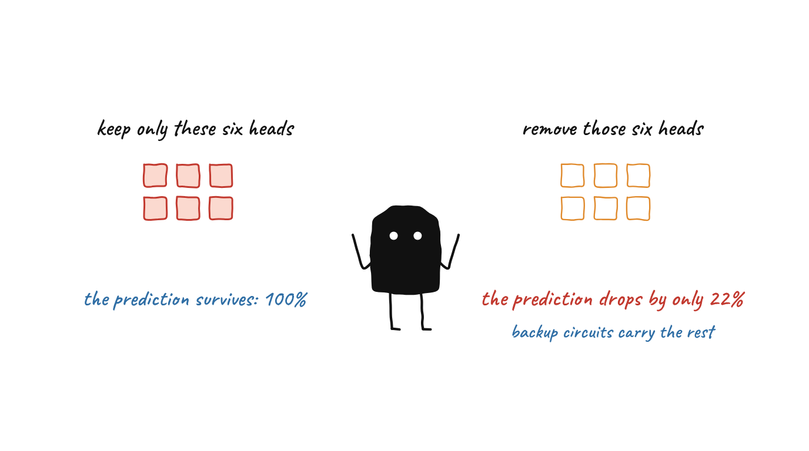
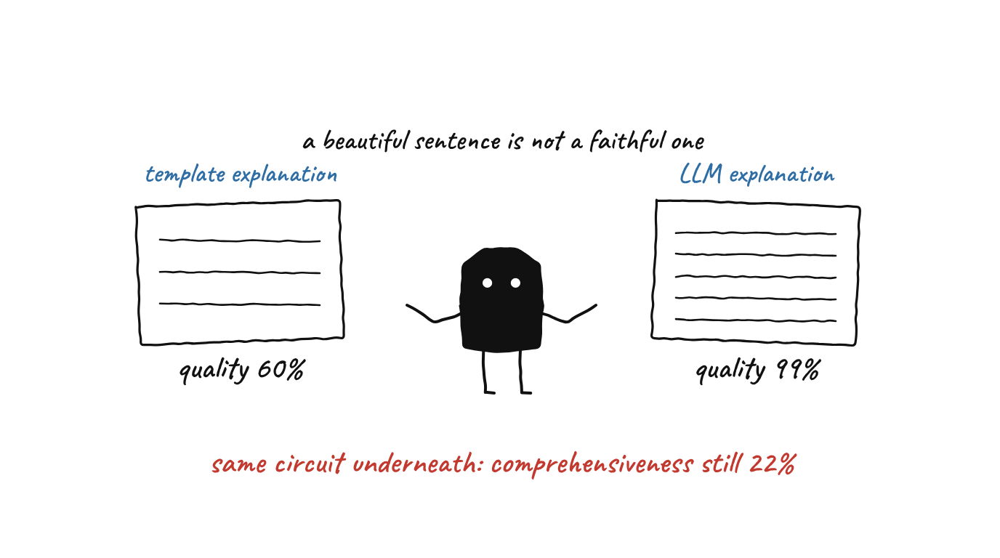
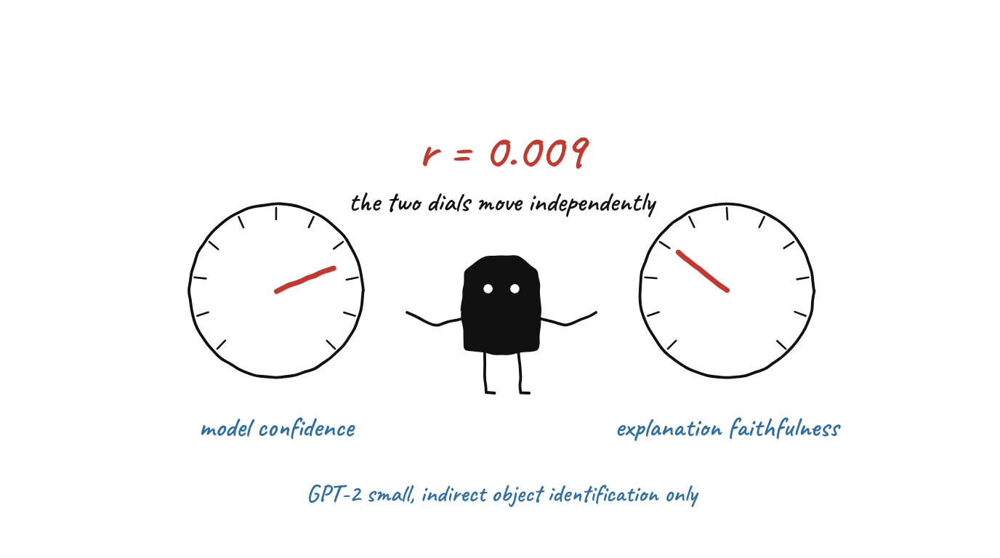

# Causally Grounded Mechanistic Interpretability and Faithful Natural-Language Explanations

## MSc Thesis Project

**Title:** Causally Grounded Mechanistic Interpretability for LLMs with Faithful Natural-Language Explanations
**Author:** Ajay Pravin Mahale (Matrikel 979783)
**Institution:** Hochschule Trier, Fachbereich Technik
**Supervisor:** Prof. Dr. Ernst Georg Haffner
**Contact:** jymh0144@hochschule-trier.de
**Submission:** May 2026

---

## Overview

This repository contains the experimental code for an MSc thesis on generating causally faithful natural-language explanations from mechanistic circuit analysis of transformer language models. The work is restricted to the Indirect Object Identification (IOI) task on GPT-2 Small and should not be interpreted as a general LLM explanation framework.

### Key contributions

1. **Circuit-to-NL pipeline.** Translates mechanistic circuit findings into natural-language explanations, evaluated end-to-end with ERASER faithfulness metrics.
2. **ERASER adaptation.** First systematic application of ERASER sufficiency and comprehensiveness metrics to mechanistic interpretability rather than rationale extraction.
3. **Template vs LLM comparison.** Quantifies what fluency adds (and what it does not). Same circuit data, two generators, +66% relative quality improvement, zero faithfulness improvement.
4. **Failure taxonomy.** Three-way classification (distributed computation, missing cited head, redundant head activity) of when and why explanations diverge from mechanisms.

### Results summary

All numbers below are from the thesis (Table 1 and Section 4), n = 50 for the main evaluation, n = 30 for the template-vs-LLM comparison.

| Metric | Value |
|---|---|
| IOI circuit coverage (6 heads) | 61.4% of logit difference |
| Sufficiency (mean) | 100.0% |
| Comprehensiveness (mean) | 22.0% |
| F1 (harmonic mean) | 36.0% |
| Beats attention baseline | in 75% of prompts |
| LLM vs template quality | +66% relative improvement (60% to 99%) |
| Confidence x comprehensiveness | r = 0.009 |
| L10H10 appears in failures | 82% |

### Three findings worth highlighting

- **Sufficient does not mean necessary.** The six-head circuit retains the full prediction on its own (100% sufficiency) but removing it only drops the prediction by 22%. Backup mechanisms cover the rest. Reporting only sufficiency overstates what the explanation establishes.
- **Format is not faithfulness.** Same circuit data, template version scores 60% on quality, LLM version scores 99%. A beautifully written explanation can sit on top of a 22%-comprehensive circuit. Fluency and grounding are independent axes.
- **Confidence is not a shortcut.** Correlation between model confidence and explanation faithfulness is r = 0.009. Confidence tells you nothing about whether the explanation reflects the mechanism.

---

## The idea in one look

   
  <b>Sufficient is not necessary.</b> The six cited heads keep the whole prediction on their own, but removing them drops it by only 22%.

   
  <b>Fluent is not faithful.</b> The same circuit data gives quality 60% with a template and 99% with an LLM, and the comprehensiveness does not change.

   
  <b>Confidence is not a shortcut.</b> The correlation between model confidence and explanation faithfulness is r = 0.009 (scope: GPT-2 small, IOI only).

### The thesis as one bench

  

| On the bench | In the thesis | Where to look |
|---|---|---|
| The rack of six pegs | The six cited attention heads of the IOI circuit | `CIRCUIT_HEADS` in [`src/demo_pipeline.py`](src/demo_pipeline.py), notebook 02 |
| The template press | The template explanation generator | [`src/explainer.py`](src/explainer.py), notebook 03 |
| The LLM press | The LLM explanation generator (needs an Anthropic API key) | `generate_learned_explanation` in `src/explainer.py`, notebooks 08 and 09 |
| Dial "quality" | Explanation quality against a checklist: 60% for the template, 99% for the LLM (n = 30) | notebook 09 |
| Dials "suff" and "comp" | ERASER sufficiency (100.0%) and comprehensiveness (22.0%), n = 50 | [`src/evaluation.py`](src/evaluation.py), notebook 05 |
| The "unchanged" lamp | Fluency and grounding are independent axes | thesis Section 4 |

Open [`docs/anatomy/thesis-bench-light.html`](docs/anatomy/thesis-bench-light.html) in a browser to scrub through it (details in [`docs/anatomy/README.md`](docs/anatomy/README.md)). The readings are the thesis means above; the slips and the order the heads light up are drawn for the picture.

### Step by step

| Step | What happens | Notebook |
|---|---|---|
| **1. Set up** | Load GPT-2 small with TransformerLens and fix the seeds. | 01 |
| **2. Find the circuit** | Reproduce the IOI circuit by activation patching and pick the six cited heads. | 02 |
| **3. Explain it** | Turn the circuit into a natural-language explanation with a template. | 03 |
| **4. Compare with baselines** | Attention-weight and random baselines. | 04 |
| **5. Measure faithfulness** | ERASER sufficiency and comprehensiveness on n = 50 prompts. | 05 |
| **6. Classify the failures** | Three modes: distributed computation, missing cited head, redundant head activity. | 06 |
| **7. Separate format from faithfulness** | An e-SNLI format study. | 07 |
| **8. Let an LLM write it** | LLM-generated explanations through the Anthropic API. | 08 |
| **9. Template against LLM** | Quality 60% against 99% (n = 30), faithfulness unchanged. | 09 |
| **10. Consolidate** | Headline metrics. | 10 |

---

## Repository structure

    thesis/
    ├── notebooks/                       # Jupyter notebooks (01-10)
    │   ├── 01_setup_test.ipynb
    │   ├── 02_ioi_reproduction.ipynb
    │   ├── 03_nl_explanation_generator.ipynb
    │   ├── 04_baselines_comparison.ipynb
    │   ├── 05_expanded_evaluation.ipynb
    │   ├── 06_failure_analysis_main.ipynb
    │   ├── 07_esnli_format_study.ipynb
    │   ├── 08_learned_nl_generator.ipynb
    │   ├── 09_template_vs_learned.ipynb
    │   └── 10_final_evaluation.ipynb
    ├── src/
    │   ├── demo_pipeline.py             # Main entry point
    │   └── 00_reproducibility_config.py
    ├── data/                            # IOI prompts, name pairs, configs
    ├── results/                         # Experiment outputs (.pkl), written by the notebooks; not committed
    ├── plots/                           # Figures used in the thesis
    ├── docs/                            # Supplementary documentation
    │   ├── anatomy/                     # Interactive bench figure (HTML, GIF, PNG) and its build files
    │   └── illustrations/               # README illustrations and their generator
    ├── requirements.txt
    ├── LICENSE
    └── README.md

---

## Quick start

### 1. Clone and install

    git clone https://github.com/designer-coderajay/Causally-Grounded-Mechanistic-Interpretability-for-LLMs-with-Faithful-Natural-Language-Explanations.git
    cd Causally-Grounded-Mechanistic-Interpretability-for-LLMs-with-Faithful-Natural-Language-Explanations
    pip install -r requirements.txt

Python 3.8+ required. CPU works; GPU recommended for full notebook runs. Model weights download automatically from HuggingFace on first use.

### 2. Run the demo

    python src/demo_pipeline.py

Produces a mechanistic explanation for a chosen IOI prompt, including the six-head breakdown, ERASER faithfulness scores, and a trust assessment. See example output below.

### 3. Reproduce the full results

Run notebooks 01 to 10 in order. Each notebook is self-contained and lands its outputs in `results/` and `plots/`.

---

## Notebook overview

| # | Notebook | Purpose | GPU |
|---|---|---|---|
| 01 | setup_test | Environment sanity check and TransformerLens load | No |
| 02 | ioi_reproduction | Circuit discovery via activation patching, reproduces Wang et al. 2023 Table 1 | Yes |
| 03 | nl_explanation_generator | Template-based natural-language explanations | Yes |
| 04 | baselines_comparison | Attention-weight and random baseline comparison | Yes |
| 05 | expanded_evaluation | Full ERASER evaluation, n = 50 prompts (canonical) | Yes |
| 06 | failure_analysis_main | Three-mode failure taxonomy (RQ3) | Yes |
| 07 | esnli_format_study | Format vs faithfulness disentanglement | No |
| 08 | learned_nl_generator | LLM-generated explanations via Anthropic API | Yes |
| 09 | template_vs_learned | Template (60%) vs LLM (99%) quality comparison, n = 30 | Yes |
| 10 | final_evaluation | Headline metrics consolidation | No |

Notebooks 08 and 09 require an Anthropic API key (set `ANTHROPIC_API_KEY` in your environment). The key is never committed.

---

## Demo output

Example for the canonical IOI prompt. Per-prompt instance values shown; dataset averages (n = 50) are in the results table above.

    INPUT:
       When Mary and John went to the store, John gave a drink to

    PREDICTION:
       "Mary" (Model Confidence: 67.7%)

    MECHANISTIC EVIDENCE:
       Head     | Role                      | Global Imp.  | Attention
       -------- | ------------------------- | ------------ | ----------------
       L9H9     | Name Mover (Primary)      |  17.4% (Avg) |  66.5% -> Mary
       L8H10    | S-Inhibition              |  12.3% (Avg) |   5.8% -> Mary
       L7H3     | S-Inhibition              |  10.3% (Avg) |   0.6% -> Mary
       L10H6    | Backup Name Mover         |   8.9% (Avg) |  10.8% -> Mary
       L9H6     | Name Mover (Secondary)    |   6.3% (Avg) |  67.2% -> Mary
       L10H0    | Backup Name Mover         |   6.2% (Avg) |  33.2% -> Mary

    FAITHFULNESS METRICS (ERASER-style, this prompt):
       Sufficiency:        100.0%
       Comprehensiveness:   28.4%   (dataset mean across 50 prompts: 22.0%)
       F1 (local proxy):    56.2%   (dataset mean: 36.0%)

    NATURAL LANGUAGE EXPLANATION:
       GPT-2 predicts 'Mary' because the Name Mover head L9H9 attends to
       Mary with 66.5% attention weight while giving John only 5.8%,
       while the S-Inhibition head L8H10 suppresses John (the giver).
       These six heads together account for 61.4% of the IOI circuit's
       logit-difference attribution.

       Caveat: The 22% mean comprehensiveness indicates that backup and
       distributed circuits carry significant computation. This explanation
       covers the primary mechanism, not the full picture.

> Per-prompt comprehensiveness varies between roughly 22% and 41% across the 50-prompt evaluation. The 22.0% headline figure is the mean. Sufficiency is consistently 100% across prompts.

> **Known discrepancy.** The role labels in the sample output above (for example L7H3 as S-Inhibition and L9H6 as Name Mover) differ for four heads from the labels in `CIRCUIT_HEADS` in `src/demo_pipeline.py` (L7H3 Name Mover (Secondary), L9H6 Name Mover (Tertiary), L10H0 Output Head). The global importance values in the demo are fixed dataset averages stored in that table, not recomputed per run. Check the head roles against Wang et al. before citing either version.

---

## Metric definitions

| Metric | Definition |
|---|---|
| Sufficiency | Performance retention when keeping only the cited heads active |
| Comprehensiveness | Performance drop when ablating only the cited heads |
| F1 (local faithfulness) | Harmonic mean of sufficiency and comprehensiveness |
| Global importance | Dataset average from ablation experiments across 50 prompts |
| Attention weight | Instance-level attention from head to token (correlational, not causal) |

ERASER protocol follows DeYoung et al. 2020, adapted from rationale extraction to attention-head selection.

---

## Scope and limitations

This work is a methodology paper on a single, well-characterized circuit, not a general LLM explanation system. Specifically:

- **Model.** Validated only on GPT-2 Small (124M parameters). No replication on Medium, Large, XL, or modern architectures.
- **Task.** Only Indirect Object Identification. Does not cover Greater-Than, induction heads, factual recall, or other circuits.
- **Sample.** n = 50 for the main evaluation, n = 30 for the LLM comparison. Statistical claims are scoped accordingly.
- **Circuit.** The top-six heads are fixed across prompts. Per-instance adaptive circuits are future work.
- **No human evaluation.** Quality scores are automatic against a checklist. Human user studies are future work.
- **Baselines.** Compared to attention-weight and random baselines. Gradient methods (Integrated Gradients, SHAP) are future work.
- **Comprehensiveness gap.** The mean 22% indicates substantial distributed computation that the six-head circuit does not explain.

Findings should not be extrapolated beyond this scope without independent validation.

---

## References

### Core methodology

- Wang, K. et al. (2023). *Interpretability in the Wild: A Circuit for Indirect Object Identification in GPT-2 Small.* ICLR 2023. https://arxiv.org/abs/2211.00593
- Nanda, N. et al. (2022). *TransformerLens.* https://github.com/TransformerLensOrg/TransformerLens
- Elhage, N. et al. (2021). *A Mathematical Framework for Transformer Circuits.* Anthropic. https://transformer-circuits.pub/2021/framework/index.html
- Conmy, A. et al. (2023). *Towards Automated Circuit Discovery for Mechanistic Interpretability.* NeurIPS 2023. https://arxiv.org/abs/2304.14997

### Evaluation and faithfulness

- DeYoung, J. et al. (2020). *ERASER: A Benchmark to Evaluate Rationalized NLP Models.* ACL 2020. https://arxiv.org/abs/1911.03429
- Jain, S. and Wallace, B. (2019). *Attention is not Explanation.* NAACL 2019. https://arxiv.org/abs/1902.10186

### LLM-based explanations

- Bills, S. et al. (2023). *Language Models Can Explain Neurons in Language Models.* OpenAI. https://openaipublic.blob.core.windows.net/neuron-explainer/paper/index.html

### Causal interpretability

- Geiger, A. et al. (2021). *Causal Abstractions of Neural Networks.* NeurIPS 2021. https://arxiv.org/abs/2106.02997
- Meng, K. et al. (2022). *Locating and Editing Factual Associations in GPT.* NeurIPS 2022. https://arxiv.org/abs/2202.05262
- Goldowsky-Dill, N. et al. (2023). *Localizing Model Behavior with Path Patching.* https://arxiv.org/abs/2304.05969

### Foundational

- Vaswani, A. et al. (2017). *Attention Is All You Need.* NeurIPS 2017. https://arxiv.org/abs/1706.03762
- Radford, A. et al. (2019). *Language Models are Unsupervised Multitask Learners.* OpenAI.
- Olah, C. et al. (2020). *Zoom In: An Introduction to Circuits.* Distill. https://distill.pub/2020/circuits/zoom-in/
- Olsson, C. et al. (2022). *In-context Learning and Induction Heads.* Anthropic. https://transformer-circuits.pub/2022/in-context-learning-and-induction-heads/index.html

---

## License

[CC BY-NC-ND 4.0](https://creativecommons.org/licenses/by-nc-nd/4.0/). View, study, and cite with attribution. Commercial use and derivatives require written permission.

---

## Acknowledgments

- Prof. Dr. Ernst Georg Haffner, supervisor, Hochschule Trier
- TransformerLens by Neel Nanda and contributors
- The mechanistic interpretability community (Anthropic, Redwood, EleutherAI)
